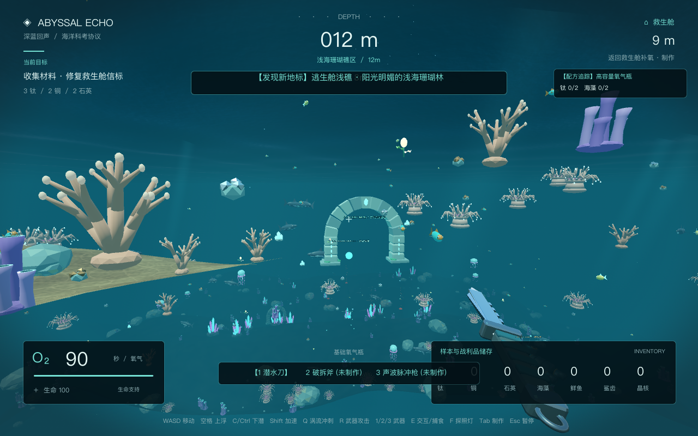
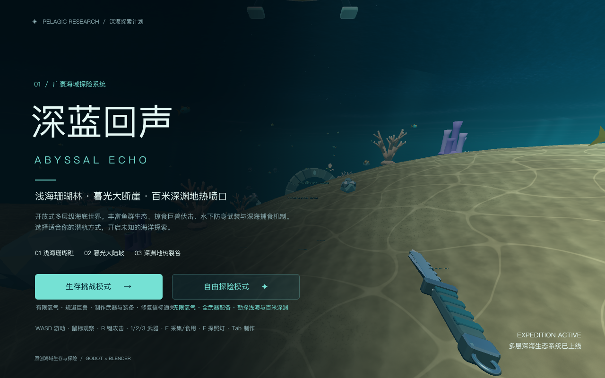
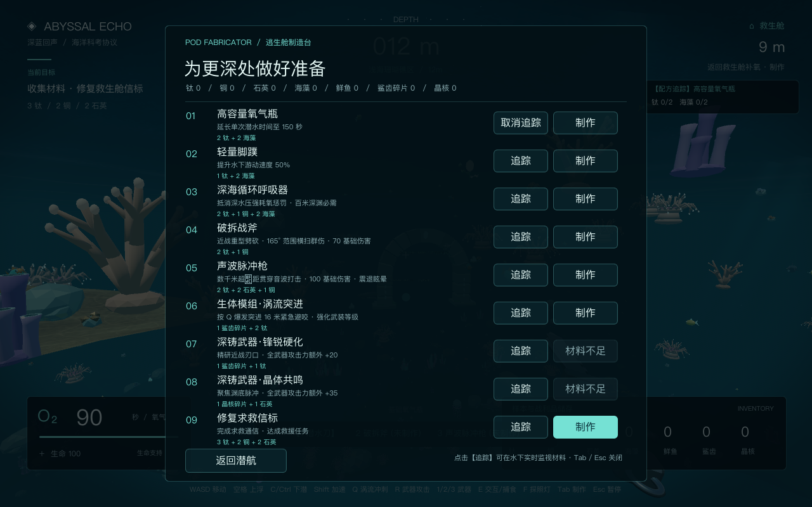
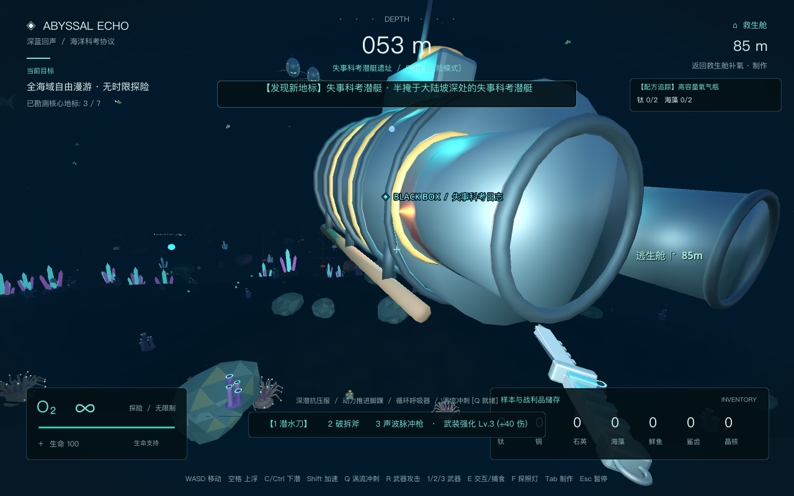
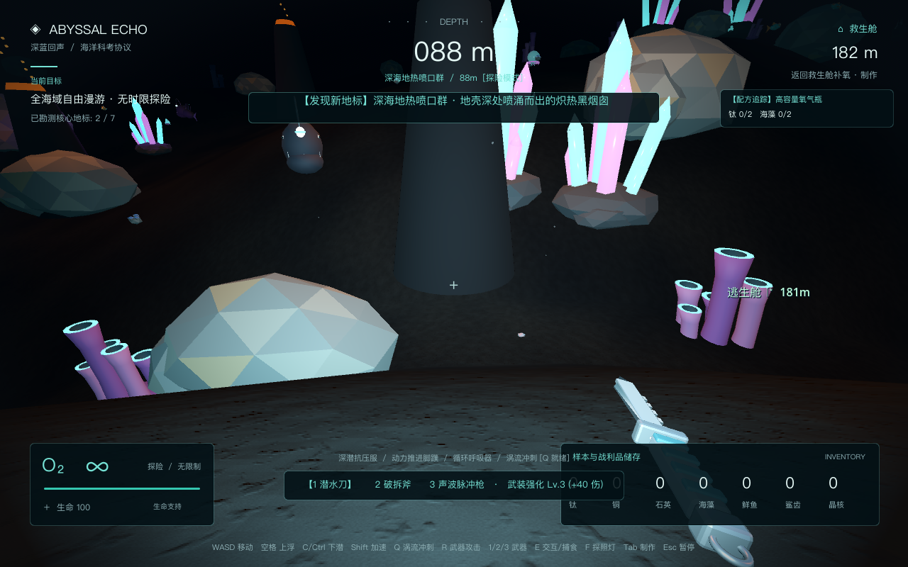

# 深蓝回声 · Abyssal Echo

使用 Blender MCP 制作原创模型、Godot 4.7.2 实现的第一人称海洋生存与探险游戏。下潜至广阔的立体多层海域，从阳光明媚的浅海珊瑚礁漫游至百米幽暗深渊的热液喷口。



| 标题界面 | 逃生舱制造台 | 失事科考潜艇 | 深渊热液喷口 |
| :---: | :---: | :---: | :---: |
|  |  |  |  |

## 操作键位指南

| 按键 | 功能操作 | 说明 |
| :--- | :--- | :--- |
| **W** | **前进** | 沿潜水员 / 坐骑 / 潜艇当前朝向平滑游动推进 |
| **S** | **后退** | 水下倒游与制动倒退 |
| **A** | **左拐** | 左转视角偏转，航向左旋导航（与 W 组合实现顺滑左拐弯） |
| **D** | **右拐** | 右转视角偏转，航向右旋导航（与 W 组合实现顺滑右拐弯） |
| **空格键** | **上升** | 水下上浮上升 |
| **Ctrl** | **下降** | 水下下潜下沉 |
| **C** | **单手能量护盾** | 按一下展开单手护盾，再按一下消除；可与所有武器同时使用 |
| **Z** | **战宠一键召回** | 按下 Z 键将所有契约战兽一键撤回，整齐列队在后方护卫 |
| **Shift** | **水下加速** | 冲刺加速游动与坐骑疾驰 |
| **G** | **坐骑骑乘 / 离鞍** | 骑乘选中的契约坐骑，或下坐骑让其转入护卫跟随 |
| **5 ~ 0** | **选择出战坐骑** | 在已驯服的最多 20 只猛兽间自由指定当前出战坐骑 |
| **4** | **光标指示枪** | 切换至 4 号战术激光指示枪 (用于标记目标指挥战宠攻击) |
| **R / 左键** | **攻击 / 蓄力** | 武器挥击 / 激光发射 / 蓝光枪长按蓄力静滞大招 / 坐骑攻击 |
| **T** | **精准瞄准** | 蓝光静滞枪战术瞄准 |
| **Y** | **远距瞄准镜** | 8× 光学放大测距镜 |
| **E** | **交互 / 驯服 / 采集** | 驯服静滞猛兽、搜集母树核心、登舰、拾取战利品与矿物 |
| **1 / 2 / 3 / 4**| **切换手持武器** | 1: 潜水战术刀 · 2: 破拆战斧 · 3: 蓝光静滞枪 · 4: 光标指示枪 |
| **H** | **手持助推器** | 开启 / 收起水下便携推进器 |
| **Q** | **涡流突进** | 解锁生体模组后的急速短距离位移躲避 |
| **F** | **潜水探照灯** | 开关强力深海战术照射手电 |
| **Tab** | **制造台** | 随身查看配方与逃生舱基地建造面板 |
| **Esc** | **暂停游戏** | 打开系统暂停菜单 |

## 最新特性（生态演进与深海武装）

1. **声波枪静滞暂停与大型猛兽/BOSS契约驯服系统**：
   - **近血静滞驯服**：四大 BOSS（深渊水龙、风暴飞鱼、深渊巨章、远古灵龟）在进入近血状态（生命值低于 35%）时，使用蓝光声波枪蓄力 3 秒发射静滞光球将其冻结暂停，靠近即可按 **E** 缔结契约成功驯服！普通大型猛兽（幽影海狼、巡弋巨鲨、深海巨蛛）在静滞状态下亦可直接驯服。
   - **20 只驯服上限与倍增攻击力**：潜水员一次最多可契约拥有 **20 只深海猛兽**。**每多契约一只骑宠，整个战宠队伍的总体攻击力便提高 2 倍**（N 只战宠伤害乘数为 2^(N-1) 倍率），战队集火具有极强成长性与压迫感！
   - **双向绝对友伤免疫**：潜水员自身武器完全无法伤害自己的契约坐骑战宠；**同时坐骑与战宠也绝对无法对主人造成任何伤害**，护卫与驾乘百分之百安全可靠！
   - **一键集体召回（Z 键）**：按下 **Z 键** 即可一键鸣哨召回所有出战的战兽，立即取消攻击目标与红点标记，所有战宠瞬间归队回到人物后方列队待命。
   - **后方整齐列队跟随 · 随停随止**：随行战宠不再绕圈旋转，而是严格在人物/坐骑正后方呈阶梯编队跟随护航；潜水员前进它们随行，潜水员停下它们便同步在后方平稳止步等待指令。
   - **10 米近身活物主动索敌进攻**：无需手动下令，在 10 米以内只要出现任何未经驯服的活物或野外敌怪，战宠队伍会自发迅猛扑击围攻，清剿完毕后回到后方归位。
   - **探险模式无限生命与就地复苏机制**：彻底修复站立受伤与误传送 Bug；探险模式下潜水员生命真正无限、不受任何伤害；生存模式下若遇险或氧气耗尽，会自动**就地在当前遇险海域就近复苏**，再也不会被传送回遥远的逃生舱，完整保留远洋探险坐标。
   - **全新坐骑与潜艇操控动力学**：
     - **坐骑**：响应 **W 前进、S 后退、A 左拐、D 右拐、空格 上升、C 下降、Shift 疾驰**。转向伴随水动力自然侧倾与俯仰微调，紧密贴合海底安全高度防卡入，并支持平滑视角的稳定驾乘体验。
     - **潜艇**：重构 6-DOF 水动力模型，**A/D** 真正响应左舵与右舵偏航旋转（Yaw）并附带流体侧向倾侧（Roll），**空格/C** 控制升降压载与舰艏俯仰，**W/S** 沿艇身轴线真实前后推进，告别以往横向横移滑动感。

2. **单手能量护盾系统（C 键切换，全武器兼容）**：
   - **单手配置，武器无缝并用**：护盾装备于潜水员左臂，与右手手持的所有武器（战术刀、破拆战斧、蓝光静滞枪、光标指示枪）完全独立共存。玩家可在举盾防御的同时挥刀砍杀、蓄力射击或标记目标！
   - **一键切换常驻**：按一下 **C 键** 即可在左臂投影一面六边形全息能量盾牌并持续常驻展开，再次按下 **C 键** 即可收起消除。
   - **100% 伤害阻挡**：展开护盾期间，正前方受到野生捕食者撕咬、海兽冲击或攻击时产生力场偏转光波与金属反弹声，**完全抵消承受伤害**，生命值分毫不减。

2. **4 号武器【光标指示枪】与激光红点引战机制**：
   - **零杀伤纯战术指示**：光标指示枪本身不具备任何攻击力伤害值，专为指挥与调度契约战宠而生（按 4 键快速装备）。
   - **激光笔红线与持久小红点**：扣动扳机即可射出一道类似激光笔般的醒目红线；命中目标（敌对生物、巨兽或特定地形位置）后，目标身上会立即锁定显现一个明亮的**脉动小红点**。
   - **松手红点长存**：即便松开射击按键，红点标记仍然牢牢吸附于目标身上持续存在，直至目标被消灭或玩家标记新目标。
   - **全军出击集火**：一旦目标被打上小红点，原本在身边近距离徘徊的战宠群立刻接收指令咆哮出击，全速扑向红点位置进行猛烈围攻撕咬，消灭目标后迅速返回主人身旁继续盘旋护卫。

3. **四大领主挑战、远古母树与中央控制台终章**：
   - **四大巨兽征服**：海底世界盘踞着四大传奇深渊领主：**深渊水龙**、**风暴飞鱼**、**深渊巨章**、**远古灵龟**。唯有平息或驯服全部 4 只怪兽后，深海终局才正式开启！
   - **深海极渊母树现世**：四大领主平息后，深渊封印解除，极渊外海地图中破水苏醒一株高达 70 米的**远古深海母树**，神光通天彻地，树冠洒落漫天生物荧光孢子。
   - **圣所内部物资搜集**：潜水员游渡至深海极渊进入母树内部空灵圣所，搜集三大核心圣物：
     - ✦ 【**母树生命精华**】
     - ✦ 【**远古星核源石**】
     - ✦ 【**深海启迪之种**】
   - **返回控制台逃生通关**：集齐 3 样母树物资后返回逃生舱基地的**中央逃生控制台（Escape Console）**，操作控制台制作【**深海跃迁逃逸器**】，激发星际跃迁引擎冲破深海，正式达成游戏终章胜利！

4. **全新生态：幽影海狼群与群居鱼类（Boids 模拟）**：
   - **幽影海狼（Sea Wolf）**：中深层海域新增的凶猛流线型狼首猎手，以 3 只为一狼群开展编队巡游，具备协同围猎撕咬 AI，可被声波枪暂停后驯化为忠诚战宠与坐骑。
   - **荧光幻梭鱼（Schooling Fish）**：基于真实 **Boids 鱼群算法**（凝聚力、速度对齐、个体分离），数十条幻梭鱼在浅海珊瑚与峡谷间形成整齐划一、波浪起伏的优美鱼群；遭遇靠近时会动态四散惊扰炸群，随后在安全距离自然优美地重新集结。

1. **多样化海洋鱼类与庞大鱼群规模**：
   - 鱼类总数量从 18 条扩展至 **134 条自主游动鱼群**，涵盖浅水珊瑚鱼、深海发光小鱼、巡弋暗礁鲨鱼与百米渊底鮟鱇巨兽等 4 大物种。
2. **掠食生物攻击性与生态追猎 AI**：
   - **巡弋暗礁鲨**（浅海/大陆坡 18 条）与**深渊鮟鱇巨兽**（百米深渊 14 条）具有主动侵略性。
   - 当潜水员进入其感知范围时，捕食者会切换至狂暴追猎状态并加速扑咬，撕咬造成 24~40 点生命伤害，伴随屏幕受击红光警示；遭遇致命伤时自动触发应急救生浮力系统。
3. **强力大照射范围体积探照灯**：
   - 战术潜水手电全面升级：光照强度提升至 **9.0**，照射距离延伸至 **85 米**，光束角度扩展至 **55°**，并辅以近身柔和环境补光，清晰穿透幽暗冷寂的深渊与海沟。
4. **多样化深海武装与大幅度多目标打击系统**：
   - **统一攻击键位**：全面升级并统一为 **R 键** 执行武器挥击与射击，彻底释放鼠标观察手感。
   - **大幅度横扫与打击机制诊断升级**：重构以往单一射线细小检测架构，引入广角锥形范围打击。破拆战斧具备 **165° 广角横扫（最大 99 目标）** 与 8.5 米攻击距离，能一次性击退面前整群海兽；潜水刀支持 130° 前方多目标刺击；配合全屏大幅正弦曲线挥砍轨迹、受击镜头冲击震荡（Camera Punch）与实体光弧特效。
   - **潜水战术刀（Knife）**：初始防身武器，快速轻刃刺击（冷却 0.28s，基础伤害 32，支持 3 目标劈刺）。
   - **破拆战斧（Axe）**：重型高能双手战斧，165° 超广角全屏下劈横扫（冷却 0.55s，基础伤害 70，强力击退 16m，横扫前方全部海兽）。
   - **蓝光静滞枪**：短按 R 或鼠标左键发射一条蓝色激光，基础伤害 100，最大射程 2000 米。激光只命中沿线第一个物体，受场景障碍阻挡；明亮海面呈深蓝色，幽暗深海呈亮蓝色，随环境明暗平滑调整。
   - **双瞄准模式**：T 切换普通瞄准，Y 切换 8× 远距瞄准镜，带十字分划和测距；远距镜提高可视距离并降低观察灵敏度。
   - **静滞大招**：按住攻击键蓄力 3 秒，巨大的蓝色光球在枪口持续聚能，充满后等待松手发射。光球以 4.5 米/秒缓慢前进，接触生物、地形或其他实体后爆开，展开半径 12 米、持续 6 秒的静滞场；范围内生物的移动、攻击、骨骼和程序动画全部暂停，进入场内的生物也会冻结。暂停、打开制造台或切换武器会取消未发射的蓄力。
   - 具备第一人称武器持握、深海潜泳水流摇摆动态，按 **1 / 2 / 3** 快捷切换，按 **R** 挥击/击发。
5. **大型海兽身体碎片掉落与双轨武器攻击力强化机制**：
   - **实体碎片掉落**：击败巡弋暗礁鲨掉落高亮发光【**巨鲨齿骨碎片**】；击败深渊鮟鱇巨兽掉落幽蓝结晶【**深渊巨兽晶核**】。掉落物具有深海水下自发光信标与浮动旋转效果，极易辨识锁定。
   - **现场生物吸收强化**：准星对准掉落碎片按 **E** 拾取，潜水员外骨骼立即吸收生物活性物质：吸收鲨齿碎片直接提升 **+12 全武器攻击力**，吸收晶核直接提升 **+25 全武器攻击力**，并提升武器强化等级。
   - **逃生舱制造台深铸锻造**：在基地制造台可使用战利品进行深层加工——【锋锐硬化】（1 鲨齿碎片 + 1 钛，永久攻击力额外 +20）、【晶体共鸣】（1 晶核碎片 + 1 石英，永久攻击力额外 +35），双轨叠加打造极强深海武装。
6. **捕食发光小金鱼（野外紧急补给）**：
   - 海底游动着 54 条敏捷的**发光小金鱼**，准星对准按 **E** 即可直接捕抓并生食，立刻恢复 **+25 生命值** 与 **+20 氧气**，为长距离探险提供野外自给自足。
7. **新物种与水龙终章**：
   - 新增 12 只八足海蜘蛛和 6 只斑纹海豹，拥有独立模型与动作，支持激光命中和静滞冻结；海蜘蛛会在海床追击并使用足刺。
   - 深渊史前祭坛附近栖息着 **深渊水龙·潮汐君主**。进入领域中心 `(-50, -76, -170)` 的 36 米范围后开启 Boss 战，显示 1800 点血条与攻击预警。水龙交替盘旋、冲刺与潮汐爆发，半血后进入狂暴阶段，也可被静滞球冻结。
   - 击败水龙后两种模式都会进入终局画面并停止游戏进程；可选择重新开始。离开领域 85 米或受到致命伤返舱后，未完成的 Boss 战会重置。

## 游戏模式

游戏支持两种核心玩法模式，可在标题界面自由选择：

1. **生存挑战模式（经典体验）**
   - **资源与氧气管理**：初始 90 秒氧气，深海下潜需时刻注意氧气余量，靠近逃生舱 7 米内或浮出水面补氧，亦可就地捕抓发光小鱼补充氧气与生命。
   - **装备与武装制造**：采集矿物制作高容量氧气瓶（150秒）、动力脚蹼（移速+50%）、破拆战斧及蓝光静滞枪抵御掠食海兽。
   - **通关目标**：准备深潜装备与武器，探索深渊祭坛并击败水龙。修复求救信标属于返航准备，不会提前结束 Boss 主线。

2. **自由探险模式（无时限全域漫游）**
   - **无限时自由探索**：无倒计时，无限氧气、全武器解锁、无死亡风险，可自由探索海域；挑战并击败深渊水龙后进入终局。
   - **全海域 10 大核心地标勘测**：地标发现通过横幅 Toast 实时播报，探索全部 10 处地标触发勘测大师达成提示，不会强制中断游戏跳转结算画面，玩家可无拘无束尽情深潜。
   - **便携制造**：不受距离限制随时呼出制造台（Tab 键）。

## 地图与生态分层

海域地图从原版的 200m × 200m 大幅扩充至 **500m × 400m**，纵向深度延伸至 **105 米**，包含三个截然不同的地貌与生态层级：

- **浅海珊瑚礁区（深度 0m ~ 20m）**：波光粼粼的水面焦散与日光束，丰富多样的鹿角珊瑚、海藻林、巨型发光海葵，成群游动的发光小金鱼、巡弋暗礁鲨鱼与近岸矿物步道。
- **暮光大陆坡断崖（深度 25m ~ 58m）**：海床急剧倾斜的壮丽断崖，阳光逐渐隐没，光照转为深蓝冷调，半掩于斜坡深处的**失事科考潜艇遗址**、古代海沟遗迹拱门以及漂浮游动的发光水母。
- **深渊海床裂谷与热液喷口（深度 60m ~ 105m）**：永夜般的百米深海峡谷，矗立着 4 座炽热发光的黑烟囱火山地热喷口、发光玄武岩结晶簇柱（水晶石笋群）、史前发光巨石祭坛、游荡的凶猛深渊鮟鱇巨兽与深海发光水母群。全域海底沙质着色器随深度平滑过渡为深色玄武岩深海沉积物。

### 核心地标（探险勘测目标）

1. **逃生舱浅礁**（深度 9m）：逃生舱起点基地，安全的避难所与生命支持站。
2. **古代海沟遗迹**（深度 22m）：半掩埋于浅海与斜坡交界海床的古代巨石拱门。
3. **暮光大断崖**（深度 28m）：由浅海骤降进入深海的大陆坡断层边缘，设有发光导航浮标。
4. **失事科考潜艇**（深度 56m）：半掩埋于暮光大陆坡深处的失事深潜科考船，拥有加固耐压壳体、黄色外骨骼肋骨、反应堆微光与应急信标。
5. **深渊裂谷入口**（深度 68m）：通向百米极深暗黑峡谷的咽喉通道。
6. **深渊史前祭坛**（深度 88m）：沉眠于幽暗渊底的发光巨石遗迹阵列。
7. **深海地热喷口群**（深度 95m）：地壳深处喷涌而出的 4 座黑烟囱火山热泉，伴随滚烫熔岩与上升气柱。
8. **碧蓝晶簇海盆**（深度 36m）：生长着幽蓝发光巨晶的科考船坞海盆，停泊着高速巡航潜艇【深海斥候号】。
9. **深渊重装造船厂**（深度 96m）：沉睡于百米深海峡谷的史前重装造船厂遗址，停泊着工业级巨型潜艇【泰坦远征号】。
10. **海妖磷光珊瑚林**（深度 42m）：密布巨型发光海葵、海柳扇珊瑚群落与鬼蝠鲼群的幽绿珊瑚海谷。

### 水下载具与助推推进器

1. **水下手持迷你助推器（Seaglide · 按 H 启动）**：
   - 每次潜航初始即可随时启用；按下 **H 键** 在双手前方展开高科技流体推进器，带有前置强光探照灯、数字声呐仪表盘与旋转双叶螺旋桨，游动移速翻倍，高速巡航漫游整片大洋。
2. **深海斥候号巡航潜水艇（Scout Submarine）**：
   - 停泊于【碧蓝晶簇海盆】(95, -36, -30)。流线型轻量化水下潜水艇，透明全景气泡座舱盖与双侧矢量涵道旋翼，巡航速度 25 m/s，冲刺达 36 m/s（70节）。配备双联装**高频声波鱼雷**（120 点单发伤害），射速快并强力击退掠食海兽。
3. **泰坦远征号巨型核潜艇（Titan Heavy Submarine）**：
   - 停泊于【深渊重装造船厂】(-110, -96, -185)。长达 24 米的重型工业级钛合金潜艇，配备多层指挥桥楼观景舷窗、围壳舵与四联装尾部巨型推进涡轮。装甲高达 2800 点耐压生命值，配备毁灭级**泰坦震荡重型鱼雷**（360 点范围伤害，22 米大范围冲击波震晕群兽）。
4. **驾驶与离舰操作**：
   - 靠近潜水艇准星出现提示后按 **E** 登舰驾驶；潜艇座舱自带独立生命支持系统（舱内无限氧气），海兽撕咬由潜艇外壳承受；在驾驶舱内按 **E** 安全离开潜艇，潜艇将停泊于当前水域供随时返航。

## 开始

Windows 双击 **开始游戏.bat**；macOS 双击 **开始游戏.command**；本项目已在 `.tools/Godot.app` 准备好本地 macOS 引擎。也可以在 Godot 4 中导入 `project.godot`，按 F6/F5 运行主场景。

```sh
.tools/Godot.app/Contents/MacOS/Godot --path .
```

首次在其他机器打开时，先用 Godot 编辑器导入项目和 GLB 资源。本地引擎不纳入 Git；下载来源见 [引擎说明](docs/runtime-setup.md)。

## 操作与按键

| 操作 | 按键 |
| --- | --- |
| 游泳 / 观察 | WASD / 鼠标 |
| 上浮 / 下潜 | 空格 / Ctrl 或 C |
| 加速冲刺 | Shift（生存模式下略微加快耗氧） |
| 手持迷你助推器 | **H**（初始随时可用，移速翻倍） |
| 武器攻击 / 激光射击 | 短按 **R** 或鼠标左键 |
| 潜艇车载鱼雷攻击 | 驾驶潜艇时按 **R** 或鼠标左键 |
| 静滞大招 | 装备蓝光枪后，长按 **R** 或左键 **3 秒**，松手发射 |
| 普通瞄准 / 远距瞄准镜 | **T** / **Y**（再次按下退出） |
| 武器切换 | **1** 战术小刀 / **2** 破拆战斧 / **3** 蓝光静滞枪 |
| 采集矿物 / 捕食小鱼 / 潜艇登舰与离舰 | **E**（靠近潜水艇或准星对准目标） |
| 打开制造台 | **Tab** |
| 战术潜水探照灯 | **F** |
| 暂停 / 返回 | **Esc** |

海床共散布 **100 处发光矿物资源**、**134 条自主演进游动鱼群**（含 54 条可食用小鱼、32 条高威胁掠食者）及 **28 处发光水母生态**。

## 制作与强化配方

| 制作 / 强化 | 材料 | 效果 |
| --- | --- | --- |
| 高容量氧气瓶 | 2 钛 + 2 海藻 | 氧气上限提升至 150 秒（生存模式） |
| 动力脚蹼 | 1 钛 + 2 海藻 | 游泳速度提升 50% |
| 破拆战斧 | 2 钛 + 1 铜 | 解锁重型近战战斧，70 基础伤害，165° 广角横扫前方群兽 |
| 蓝光静滞枪 | 2 钛 + 2 石英 + 1 铜 | 蓝色激光、双瞄准模式和 3 秒蓄力静滞球 |
| 深铸武器·锋锐硬化 | 1 鲨齿碎片 + 1 钛 | 研磨近战刃口与弹片，全武器攻击力额外 +20，提升强化等级 |
| 深铸武器·晶体共鸣 | 1 晶核碎片 + 1 石英 | 聚焦渊底声学共鸣腔，全武器攻击力额外 +35，提升强化等级 |
| 求救信标 | 3 钛 + 2 铜 + 2 石英 | 完成返航通信准备；击败水龙后终局获胜 |

## 项目与资产

- `scripts/`：潜水控制器、武器持握与程序化打击系统、生态鱼群与掠食者追猎 AI、生存与探险状态管理、HUD 动态仪表盘、游戏总控。
- `scripts/energy_orb.gd`、`scripts/marine_creature.gd`：球体连续碰撞检测、静滞弹，以及海蜘蛛、海豹和水龙的程序化模型与动作。
- `shaders/`：海底深度感知沙质衰减着色器（`sand.gdshader`）、动态海浪表面着色器（`water.gdshader`）、阳光束体积光（`shaft.gdshader`）。
- `assets/models/`：Blender 5.2.1 LTS 导出的 28 个原创高品质 GLB 资产模型（新增巨型鬼蝠鲼、深海绿海龟、深渊发光巨乌贼、底栖巨螯蟹、扇形海柳珊瑚、热泉巨型管虫群落、海星与发光海胆群；升级潜水刀/战斧/蓝光静滞枪、发光小金鱼、巡弋暗礁鲨、深渊鮟鱇巨兽、逃生舱、失事潜艇、鹿角珊瑚、管状珊瑚、海葵、水晶柱、水母、海藻与海床岩石等）。
- `tools/create_assets.py`：可复现的 Blender 建模与材质导出脚本。
- `assets/audio/`：低多边形潜航环境音效与矿物采集音。
- `docs/`：高质量截图与运行配置指南。

## 自动化测试与验证

```sh
# 1. 生存/探险模式、武器制作、捕食小鱼、伤害计算规则单元测试
.tools/Godot.app/Contents/MacOS/Godot --headless --path . -s tests/smoke.gd

# 2. 真实 3D 物理、134 条鱼群生态、掠食攻击与受创、武器切换与实弹打击、地标发现及通关端到端验证
.tools/Godot.app/Contents/MacOS/Godot --headless --path . -- --smoke-world

# 3. 激光遮挡、T/Y 瞄准、3 秒蓄力松手、光球碰撞、各物种冻结恢复、Boss 战与终局
.tools/Godot.app/Contents/MacOS/Godot --headless --path . -s tests/laser_stasis_boss.gd
```

## 构建与发布

- **Windows 一键打包**：直接双击 `一键打包.bat`，即可在 `build/` 目录下生成包含全部资源的单文件 `深蓝回声.exe`。
- **导出预设**：项目根目录已包含标准 `export_presets.cfg`，可直接配合 Godot 4 导出模板使用。

## 许可证

本项目基于 [MIT 许可证](LICENSE) 开源。
